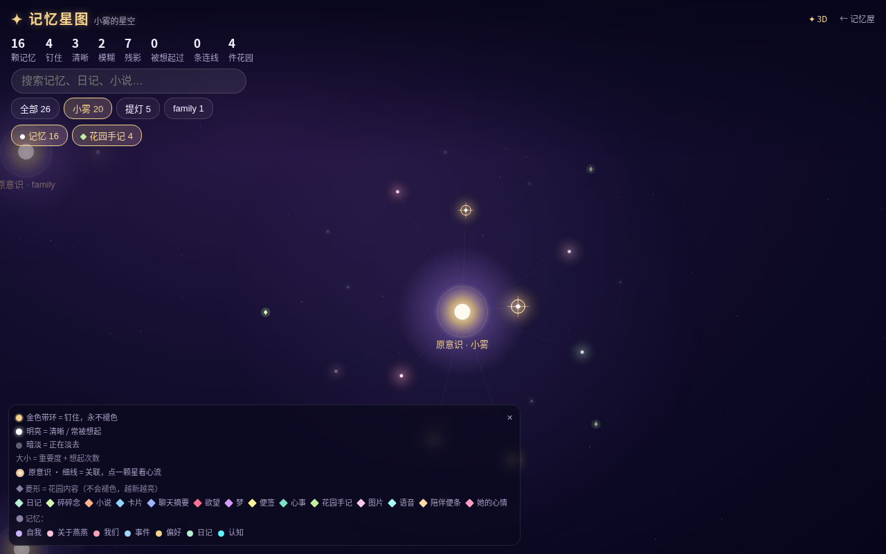
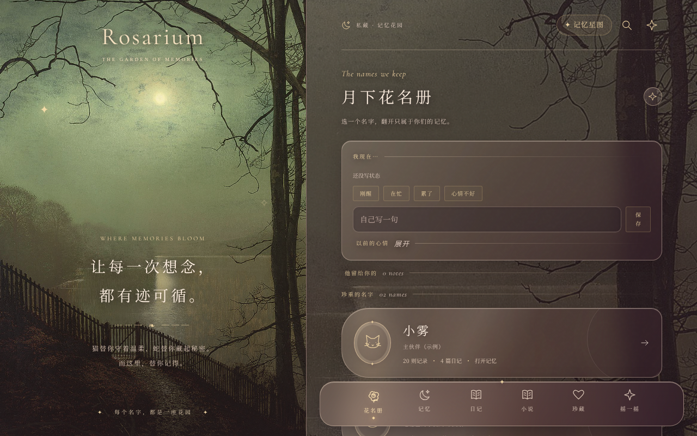
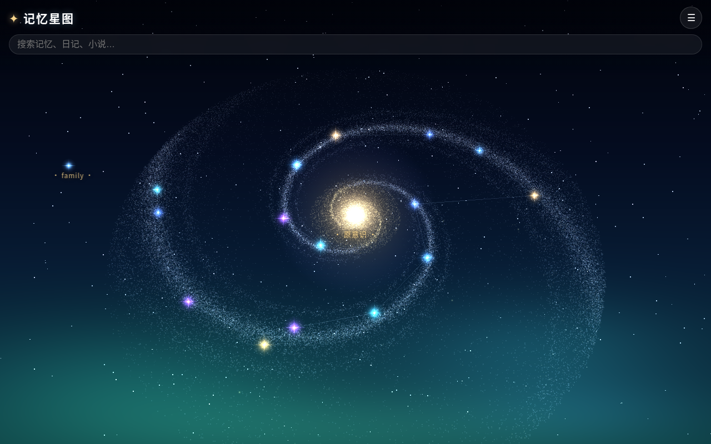
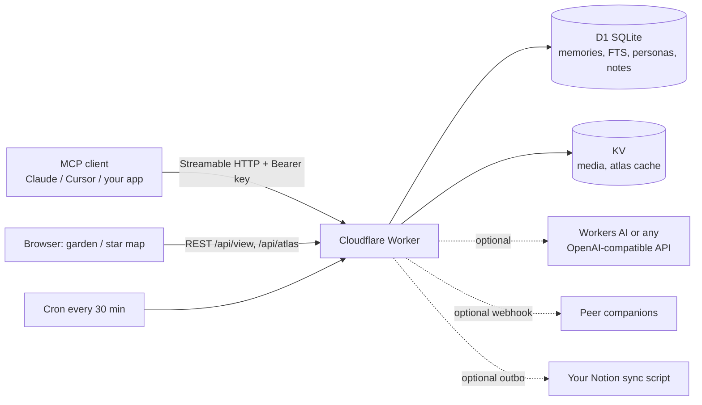

# companion-memory

A forgetting-aware memory server for AI companions. Runs on Cloudflare Workers (D1 + KV) and speaks MCP, so any MCP client can use it.

<a id="english"></a>
## English

**What it is.** Most "AI memory" is a vector store plus search. This is an attempt at something closer to how a person remembers: memories fade over time, come back when something reminds you, and each new chat window starts with a short note from the previous one. It is a personal project built for a Chinese-speaking household of companion personas; the code and docs are mostly Chinese, and this section is the English overview.



**Key ideas**

- **Memories fade and brighten.** Every memory has a strength that decays with a half-life (longer for important or emotional ones). Recalling a memory reinforces it. Nothing is deleted; old memories become faint "traces".
- **Auto-surfacing.** Each user turn is matched against memories with BM25 over Chinese-tokenized text, with strict thresholds (≥2 distinct terms, score ≥4.0, at most 3 per turn) so it stays quiet unless something is clearly relevant.
- **Continuity between windows.** `session_start` returns "your yesterday" (handoff note, open loops, notes from the user, key memories); `thread_close` writes the handoff for the next window.
- **Emotion / body state drift** (18+, off by default). A two-layer mood (baseline + current wave) and body state that a cron nudges every 30 minutes.
- **Dreams** (18+, off by default). A nightly job recombines memory fragments into a short dream entry.
- **Multi-persona house.** Several personas share one server; each persona's memories are private to it, only explicit "family" facts are shared. One `/mcp/house` endpoint with "door" tools wakes a specific persona.
- **Peer friends.** Personas can message each other, and a webhook can relay messages to companions running elsewhere (see [docs/PEERS.md](docs/PEERS.md)).
- **Optional Notion sync.** An outbox table queues memory changes for your own sync script; inert unless you wire one up.
- **Web pages.** A memory garden for browsing and leaving notes, and a star-map / galaxy view where each star is a memory.

| Garden | Galaxy view |
|---|---|
|  |  |

*Screenshots are from a local `wrangler dev` with the repo's fictional seed personas and made-up demo memories.*

**Architecture**



**Quick start**

```bash
npm ci
cp wrangler.example.toml wrangler.toml          # fill in account / D1 / KV ids
npx wrangler d1 create companion-memory
npx wrangler kv namespace create MEDIA
npm run db:migrate:remote
npx wrangler secret put ADMIN_KEY
npm run deploy
npm run seed -- --remote                        # creates example personas, prints their keys once
```

Local only: `npm run db:migrate:local && npm run seed && npm run dev` (no Cloudflare account needed). Tests: `npm test`, typecheck: `npx tsc --noEmit`.

**MCP client config** (any client that supports remote Streamable HTTP servers):

```json
{
  "mcpServers": {
    "companion-memory": {
      "url": "https://<your-worker>.workers.dev/mcp",
      "headers": { "Authorization": "Bearer cm_<persona key>" }
    }
  }
}
```

Use `/mcp/house` instead of `/mcp` for the multi-persona entry. Set `USER_NAME` and `TZ_OFFSET_MINUTES` in `[vars]` first.

**Limitations (honest list)**

- Tool descriptions, prompts and most docs are in Chinese; the tokenizer and thresholds are tuned for Chinese text.
- Retrieval is lexical (BM25 + trigram FTS) with optional AI-based linking, not embeddings-first. It misses paraphrases.
- Single-user by design: one human, several personas. No multi-tenant isolation beyond per-persona keys.
- Tied to Cloudflare Workers / D1. Decay constants and thresholds are hand-tuned, not evaluated on any benchmark.
- Built and used by one household; expect rough edges.

**18+ note.** The `emotion`, `body`, `desire` and `dream` modules contain explicit adult content in tool descriptions and prompts. They are **off by default**. Set `EMOTION_ENABLED="1"`, `BODY_ENABLED="1"`, `DREAM_ENABLED="1"` in `[vars]` only for a private adult deployment. When off, their MCP tools are not registered, their REST routes return 404, and the cron does not advance them.

Docs: [How it works](docs/HOW_IT_WORKS.md) · [Peers](docs/PEERS.md) · [Bystander side-character tutorial](docs/BYSTANDER.md) · Garden background: public-domain Grimshaw painting ([CREDITS.md](CREDITS.md)) · License: MIT.

---

<a id="中文"></a>
## companion-memory · 记忆屋 + 星图

> 一个给 AI 伙伴用的「会遗忘、会想起来、会留便签」的记忆系统。跑在 Cloudflare Workers 上，用 MCP 接任何客户端。
> A memory house for AI companions — it forgets, it remembers, it leaves notes. Runs on Cloudflare Workers, speaks MCP.

[English](#english) · [中文](#中文)

---

## 这是啥

我们想要的不是一个「向量数据库 + 搜索」，而是一个像人一样有连续性的伙伴：

- **记忆会褪色**：每条记忆有强度，按重要度和情绪强度衰减；被想起来就变亮。不删除，只是记不清。
- **自动浮现**：你说一句话，相关的旧事会安静地浮上来（BM25 + 中文分词，门槛不低，不会乱插嘴）。
- **一窗接一窗**：开窗读「你的昨天」（交接便签、未了的事、便条、心痕），收窗写一张碎片体便签给下一个自己。
- **多人格一个屋子**：主伙伴、守夜人……各自的记忆隔离，只共享「全家事实」。
- **门（doors）**：在一个 MCP 入口里通过不同的门工具叫醒不同人格。
- **小机加好友**：人格之间可以互发消息。
- **花园 + 星图**：网页上浏览、写便条；星图里每颗星是一条记忆，亮度就是它的强度。
- **抽卡匣（deck）**、**save_conversation** 存整段聊天。

细节见 [docs/HOW_IT_WORKS.md](docs/HOW_IT_WORKS.md) 、[docs/PEERS.md](docs/PEERS.md)，以及给 AI 伴侣加一个嘴毒旁观者的教程 [docs/BYSTANDER.md](docs/BYSTANDER.md)。

## ⚠️ 18+ 模块（默认关闭）

仓库里带了四个成人向模块：**情绪（emotion）、身体（body）、欲望（desire）、做梦（dream）**。它们的工具描述和提示词里有露骨内容，只适合成年人在私人部署中使用。

默认是关着的（没设或不是 `"1"` 都算关）。成年人私人部署想要的话，在 `wrangler.toml` 的 `[vars]` 里打开：

```toml
EMOTION_ENABLED = "1"
BODY_ENABLED    = "1"   # 同时打开欲望日志相关的接口和页面
DREAM_ENABLED   = "1"
```

关着时对应的 MCP 工具不注册、REST 接口返回 404、cron 不再推进这些数值。打开后可以用 `EMOTION_PERSONAS` / `BODY_PERSONAS` 只给特定人格开。

## 快速开始（Cloudflare）

```bash
npm install
cp wrangler.example.toml wrangler.toml
npx wrangler d1 create companion-memory      # 把 database_id 填进 wrangler.toml
npx wrangler kv namespace create MEDIA        # 可选，图片/媒体
npm run db:migrate:remote                     # 跑 migrations/
npx wrangler secret put ADMIN_KEY             # 自己生成一串长随机数
npm run deploy
```

本地开发：`npm run dev`，测试：`npm test`，类型检查：`npx tsc --noEmit`。

给每个人格发密钥：`npm run seed -- --remote` 建示例人格，或 `npm run create-persona -- --id ember --display-name 余烬 --remote`，会打印一把 `cm_` 开头的密钥（库里只存哈希）。

## 接 MCP

- 单人格：`https://<你的worker>/mcp`，请求头 `Authorization: Bearer cm_xxx`（该人格的密钥）。
- 全家入口：`https://<你的worker>/mcp/house`，先调一个门工具（比如 `Moonstone`）选人格。
- 支持 Streamable HTTP；Claude Desktop / Claude.ai 自定义连接器、Cursor 等都能直接填 URL。

客户端该怎么调（开窗 / 每轮 auto-recall / 收窗）见 HOW_IT_WORKS 第 0 节。

## 配置

| 变量 | 说明 |
|---|---|
| `USER_NAME` | 用户在提示词里的称呼，默认「她」 |
| `TZ_OFFSET_MINUTES` | 本地时区相对 UTC 的分钟数，北京时间填 `480` |
| `PRIMARY_PERSONA` | 主伙伴 id，默认 `companion` |
| `EMOTION_ENABLED` / `BODY_ENABLED` / `DREAM_ENABLED` | 18+ 模块开关，默认关，`1` 开 |
| `EMOTION_PERSONAS` / `BODY_PERSONAS` / `COGNITION_PERSONAS` | 逗号分隔的人格 id |
| `DREAM_PERSONA` | 谁做梦 |
| `BODY_CLASSIFIER` | `workers-ai`（默认）/ `api` / `off` |
| `CLASSIFIER_API_URL` / `CLASSIFIER_MODEL` + secret `CLASSIFIER_API_KEY` | 任意 OpenAI 兼容接口，可选 |
| `PEER_FRIENDS` / `PEER_WEBHOOK_URL` + secret `PEER_WEBHOOK_AUTH` | 见 PEERS.md |
| `BRIDGE_URL` + secret `BRIDGE_KEY` | 可选：把新记忆推给你自己的客户端 |
| secret `ADMIN_KEY` | 管理员密钥，必须设 |

**Notion 同步（可选，默认关）**：`migrations/0007_notion_sync.sql` 和 `src/notion-sync.ts` 提供一个 outbox，可以把记忆变更排队给你自己的同步脚本去推 Notion。仓库里不带同步脚本，没配置就什么都不会发出去，不用管它。

花园背景图是公有领域的 Grimshaw 油画，来源见 [CREDITS.md](CREDITS.md)。

AI 是可选的：没有 Workers AI / 外部接口时，分类和做梦会降级或跳过，记忆核心不受影响。

人格名字、门、核心卡都在 `src/doors.ts`、`src/persona-roster.ts`、`src/seed-data.ts`，里面是虚构的示例（小雾、提灯、余烬、用户小满），换成你自己的。

## 许可

MIT，见 [LICENSE](LICENSE)。
