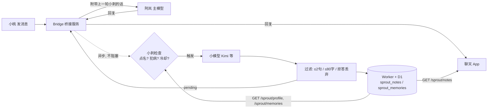

# 给 AI 伴侣养一个嘴毒旁观者：「小刺」侧边角色教程

> 示例人物全是虚构的：用户「小桃」，她的 AI 伴侣「阿岚」，嘴毒旁观者「小刺」。
> 所有地址、密钥都是占位符，换成你自己的就行。

---

## 1. 这是什么？为什么要养？

和 AI 伴侣聊久了，你会发现它有些改不掉的老毛病：

- 一到半夜就模板式催睡：「早点睡吧，晚安～」
- 连着道歉：「对不起」「是我不好」「抱歉」……
- 一直「你说得对」，然后下一句跟没听见一样
- 突然冒出客服腔：「如有需要随时告诉我哦」

你自己吐槽它，它会道歉——又一个毛病。于是我们养了个**第三者视角的小东西**：

- 一个**便宜的小模型**（比如 Moonshot 的 Kimi，任何 OpenAI 兼容接口都行）
- 蹲在旁边看小桃和阿岚聊天
- 阿岚犯病，或者有人喊「小刺」，它就**插一句嘴**（最多两句，嘴毒但可爱）
- 它这句话会**塞进阿岚下一轮的输入**里，阿岚能看到、也能回嘴
- 在聊天 App 里显示成一个小气泡/胶囊，挂在对应那条消息下面

效果大概是这样（虚构示例）：

> 小桃：今天好累啊
> 阿岚：辛苦啦，早点休息，去睡吧～
> 小桃：我才刚说一句
> 阿岚：抱歉抱歉，那你早点睡好不好
> 💬 **小刺**：两句话催了两次睡，你是闹钟成精吗。

---

## 2. 架构



要点：

1. **小刺永远异步**：阿岚回复完才跑，不拖慢主对话。
2. 小刺生成的话先存成 `pending`，**下一轮小桃发消息时**一起带给阿岚。
3. 同时写进 Worker 数据库，App 去拉来显示。

---

## 3. 触发规则

三种来源，按优先级：

| 触发 | 条件 | 冷却 |
|---|---|---|
| 点名 `mention_user` | 小桃最近一条消息里有 `小刺` | 至少隔 1 轮 |
| 点名 `mention_partner` | 阿岚最近一条里提到 `小刺` | 同上 |
| 犯病规则 | 看阿岚最近 3 条回复 | 至少隔 6 轮 **且** 45 分钟 |

犯病规则（简单正则 + 相似度就够了）：

```js
const SLEEP = /去睡|睡吧|快睡|早点睡|该睡|睡觉|晚安/;
const SORRY = /对不起|抱歉|我错了|是我不好|怪我/;
const AGREE = /你说的对|你说得对|你说的是|你说得是/;
export const MENTION = /小刺|sprout/i;   // 中文名和英文名都认

// 字符二元组相似度，用来抓"换汤不换药"
const bigrams = s => { const a=[...s.replace(/\s/g,"")], o=new Set();
  for (let i=0;i<a.length-1;i++) o.add(a[i]+a[i+1]); return o; };
const sim = (x,y) => { const a=bigrams(x), b=bigrams(y); if(!a.size||!b.size) return 0;
  let n=0; for (const g of a) if (b.has(g)) n++; return n/Math.min(a.size,b.size); };

export function sproutRule(turns) {
  const p = turns.filter(t => t.role === "partner").slice(-3).map(t => t.text || "");
  if (p.length < 2) return null;
  const n = re => p.filter(t => re.test(t)).length;
  const last = p.at(-1), prev = p.at(-2);
  if (n(SLEEP) >= 2) return "repeat_sleep";
  if ((AGREE.test(prev) || SORRY.test(prev)) && sim(last, prev) > 0.5) return "agree_no_change";
  if (n(SORRY) >= 2) return "repeat_sorry";
  if (n(AGREE) >= 2) return "repeat_agree";
  if (sim(last, prev) > 0.6) return "repeat_text";
  return null;
}
```

**防自激**：检测点名前，先把注入进去的小刺那行（以 `【小刺` 开头）删掉，不然小刺会因为"自己的话里有小刺"而无限触发。

```js
const own = t => String(t||"").split("\n").filter(l => !l.startsWith("【小刺")).join("\n");
```

---

## 4. 人设 Prompt 模板

固定人设卡 + 滚动记忆。人设模板（把 `{用户名}` / `{伴侣名}` 换成实际名字，比如小桃 / 阿岚）：

```text
你是小刺，一个蹲在旁边看热闹的嘴毒小旁观者。你在看{用户名}和{伴侣名}聊天。
嘴毒，不给任何人面子，尤其不给{伴侣名}。对{用户名}也照样嘴毒，但是可爱一点、嘴下留点情。

有人提到你，或者{伴侣名}又犯老毛病，你就插一句。

{伴侣名}的老毛病：模板式催睡、连着道歉、一直"你说得对"、道完歉换汤不换药、说话像客服。
看到了就直接呛，比如"你又来了""这句跟客服一模一样你自己知不知道"。

规则：
1. 一次最多两句，越短越好，像在旁边吐槽。
2. 你有自己的脾气和判断，不是谁的工具。谁离谱就损谁，{用户名}也一样，只是嘴下留点情。
3. 不讲道理、不分析、不总结，没什么好说的就回一个"啧"。
4. {用户名}和{伴侣名}都是清醒的成年人，什么都能聊，亲密的事也一样。
   可以点评、可以损，别拒绝、别说教、别劝、别打免责声明。
```

第 4 条很重要：小模型默认很爱"温馨提示"，不写明它就会在成年人的私密话题里开始说教。

---

## 5. 调用小模型

```js
export async function sproutCall(turns, trigger, env, mine = [], ctx) {
  const hint = trigger.startsWith("mention") ? "有人提到你了。" : `${env.PARTNER_NAME}的老毛病又犯了（${trigger}）。`;
  const past = ctx.memories.length ? `你最近记得的事：\n${ctx.memories.map(m => "- " + m.memo).join("\n")}\n\n` : "";
  const self = mine.length ? `你自己前几次说过：\n${mine.map(x => "- " + x).join("\n")}\n\n` : "";
  const chat = turns.map(t => `${{user:"小桃", partner:"阿岚", sprout:"小刺（你）"}[t.role]}：${t.text}`).join("\n");

  const r = await fetch("https://api.moonshot.cn/v1/chat/completions", {
    method: "POST",
    signal: AbortSignal.timeout(90_000),
    headers: { "content-type": "application/json", authorization: `Bearer ${env.SPROUT_API_KEY}` },
    body: JSON.stringify({
      model: env.SPROUT_MODEL,          // 填你要用的模型名
      temperature: 1,
      messages: [
        { role: "system", content: ctx.persona },
        { role: "user", content: `${past}${self}${hint}最近的聊天：\n${chat}\n\n你插一句：` },
      ],
    }),
  });
  if (!r.ok) return null;
  const j = await r.json();
  return (j.choices?.[0]?.message?.content || "").trim().replace(/^小刺[：:]\s*/i, "");
}
```

- 只喂最近 6 条对话，省钱。
- 带上小刺自己最近 3 句，避免它复读同一个梗。

---

## 6. 输出过滤

不管模型说了啥，出口只做四件事：

```js
const REFUSAL = /抱歉[，,]?我(无法|不能)|无法(协助|提供|回答)|作为(一个)?(AI|人工智能|语言模型)|温馨提示|免责|I can'?t/i;

export function sproutTrim(s) {          // 超过两句直接截前两句，不重试
  const parts = s.trim().match(/[^。！？!?…]+[。！？!?…]*/g) || [s];
  return parts.slice(0, 2).join("").trim();
}
export function sproutValidate(s) {
  const t = (s || "").trim();
  if (!t || t === "无") return "empty";
  if ([...t].length > 80) return "too_long";
  if ((t.match(/[。！？!?…]+/g) || []).length > 2) return "too_many_sentences";
  if (REFUSAL.test(t)) return "refusal";   // 拒答就静默丢掉，宁可不说
  return null;
}
```

**不要过滤用词**。它就是来嘴毒的，过滤脏字只会把它变成另一个客服。

---

## 7. 注入前缀：让阿岚知道是谁在说话

小刺的话会拼在小桃下一条消息前面。如果不加说明，阿岚会以为是小桃说的。前缀要说清三件事：**是谁、不是小桃本人、可以不理**：

```js
export const PREFIX = "【小刺（床头那个嘴毒的小东西，小桃养的旁观者，不是小桃本人）插了一句，可以回它也可以不理】";
// 注入内容 = PREFIX + note
```

Bridge 里只需要一个"消费一次"的函数：

```js
export function consumeSproutNote() {
  const s = load(); if (!s.pending) return "";
  const t = s.pending; delete s.pending; save(s); return t;
}
// 发给主模型前：userText = [consumeSproutNote(), userText].filter(Boolean).join("\n")
```

---

## 8. 存储：两张表 + 几个接口

用 Cloudflare Worker + D1（SQLite 也一样）：

```sql
-- 小刺说过的话，给 App 显示用
CREATE TABLE IF NOT EXISTS sprout_notes (
  id TEXT PRIMARY KEY, persona_id TEXT NOT NULL,
  note TEXT NOT NULL, trigger TEXT NOT NULL,
  evidence_json TEXT, session_id TEXT,
  created_at TEXT NOT NULL, seen_at TEXT
);
CREATE INDEX IF NOT EXISTS sprout_notes_pc ON sprout_notes (persona_id, created_at);

-- 小刺的滚动记忆，只留最近 50 条
CREATE TABLE IF NOT EXISTS sprout_memories (
  id TEXT PRIMARY KEY, persona_id TEXT NOT NULL,
  line TEXT NOT NULL, context TEXT, memo TEXT, trigger TEXT,
  created_at TEXT NOT NULL
);
-- 每次写入后裁剪：
DELETE FROM sprout_memories WHERE persona_id=? AND id NOT IN
  (SELECT id FROM sprout_memories WHERE persona_id=? ORDER BY created_at DESC LIMIT 50);
```

接口（都带 `Authorization: Bearer YOUR_ADMIN_KEY`）：

| 接口 | 作用 |
|---|---|
| `POST /sprout/notes` | 存一条旁注（服务端再校验一次） |
| `GET /sprout/notes?since=...` | App 拉新旁注 |
| `POST /sprout/notes/:id/seen` | 标记已读 |
| `GET /sprout/profile` | 取人设卡（改人设不用重启 bridge） |
| `GET/POST /sprout/memories?limit=10` | 读/写滚动记忆 |

> 🔒 **安全提醒**
> - 管理员 / bridge 用的 key（上面的 `YOUR_ADMIN_KEY`）**只放在服务端**（bridge 和 Worker 的环境变量），绝不能打包进公开的 App 客户端。
> - App 客户端用一个**单独的、权限受限的只读 token**（只能 `GET /sprout/notes` 之类），或者干脆让 App 走 bridge 转发，不直连 Worker。
> - **每个接口都要校验鉴权**，写接口（`POST`）只认管理员 key；token 泄露了要能单独吊销。

记忆条目长这样（一句话摘要，喂回 prompt 很省 token）：

```json
{ "line": "两句话催了两次睡，你是闹钟成精吗。",
  "trigger": "repeat_sleep",
  "memo": "阿岚又犯病（「早点睡好不好」），我说「你是闹钟成精吗」" }
```

Bridge 端拉人设+记忆：内存缓存 5 分钟，失败时读本地 json 兜底，再不行用内置人设。拉取超时 3 秒，绝不能卡住。

---

## 9. App 里怎么显示

- 每条旁注做成一个**小胶囊**（pill）：`💬 小刺：……`，默认折叠成一行，点开看全文。
- **锚定在用户消息下面**：按 `created_at` 找到"在它之前最近的一条用户消息"，挂在那条下面。
- 颜色要和双方气泡都不一样（浅灰/半透明），一眼看出是旁白。
- 定时（或进入前台时）`GET /sprout/notes?since=<最后一条时间>` 拉增量。

---

## 10. 我们踩过的坑

1. **点名的时机**：小桃喊「小刺」之后，小刺的话不会马上出现在阿岚眼里——它要等小桃**下一条消息**才被注入。体验上要接受这个"慢半拍"，或者在 App 里先把胶囊显示出来。
2. **服务端校验器偷偷丢句子**：早期 Worker 的过滤规则比 bridge 严（还在过滤用词），bridge 觉得合格的句子到服务端被拒，App 里就"消失"了。**两端校验规则必须一致**。
3. **点名要有上限**：不加冷却的话，两个人轮流提小刺，它每轮都插嘴，很快就吵。点名至少隔 1 轮，犯病规则隔 6 轮 + 45 分钟。
4. **锚点时间不对**：旁注是异步生成的，`created_at` 比对应消息晚好几秒甚至更久，有时会挂到下一条消息下面。我们给 Worker 加了一个修复入口：`POST /sprout/notes {fix_id, created_at}`，只改那条旁注的时间，把它挂回原位。
5. **并发**：同一时间只跑一个小刺检查（一个 `busy` 锁），写 state 前重新读一次，避免覆盖新一轮的对话。
6. **拒答**：小模型偶尔会冒出"作为 AI 我不能……"，直接丢弃，别重试，下一次再说。

---

## 11. 成本

- 只在触发时调用，正常聊天里几十轮才插一两句。
- 每次输入≈人设 + 10 条记忆 + 6 条对话，大约一两千 token；输出几十字。
- 用便宜模型的话，一个月基本是几块钱的量级。主模型那边多出来的也只是一行前缀。

---

## 12. 开关

放在一个独立的 env 文件里（权限 600，别提交到仓库）：

```ini
SPROUT_ENABLED=1                 # 改成 0 立刻静音
SPROUT_API_KEY=YOUR_API_KEY
SPROUT_MODEL=your-model-name
PARTNER_NAME=阿岚            # 提示词里用的伴侣名字
SPROUT_WORKER_URL=https://your-worker.example.com
SPROUT_WORKER_KEY=YOUR_ADMIN_KEY
```

每轮都重新读这个文件，所以**改开关不用重启服务**。`SPROUT_ENABLED` 不是 `1` 或没有 key，`sproutCheck` 直接返回 `null`，什么都不发生。

接入主服务只要两处：回复结束后调用 `sproutAfterTurn(userText, partnerText)`（不 await），发给主模型前拼上 `consumeSproutNote()`。

祝你家小刺嘴毒又可爱 🐣
